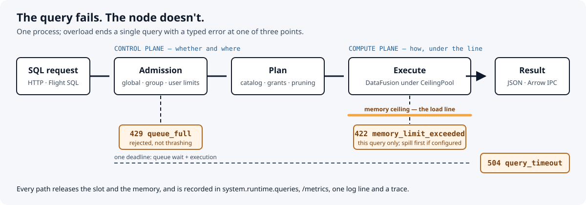

<a id="top"></a>

**English** · [Português (Brasil)](README.pt-BR.md)

<p align="center">
  
</p>

<h1 align="center">Plimsoll</h1>

<p align="center">
  <b>The query fails. The node doesn't.</b><br>
  An open lakehouse SQL engine in Rust, on Apache DataFusion and Iceberg, where overload ends one query — never the process.
</p>

<p align="center">
  <a href="#see-it-work">Demo</a> · <a href="#quickstart">Quickstart</a> · <a href="#how-it-works">Architecture</a> · <a href="docs/reference.md">Reference</a> · <a href="docs/adr/README.md">Decisions</a>
  <br>
  <sub>experimental <code>0.x</code>, build-to-learn — see <a href="CHANGELOG.md">CHANGELOG</a></sub>
</p>

<p align="center">
  <a href="https://github.com/Joaolucas2210/plimsoll/actions/workflows/ci.yml"></a>
  <a href="https://github.com/Joaolucas2210/plimsoll/releases"></a>
  <a href="LICENSE"></a>
</p>

A query engine that runs out of memory usually takes every other query down with it. Plimsoll treats overload as **a per-query outcome**: one process-wide memory ceiling, admission limits and one deadline turn a runaway query into a typed error (`422`, `429`, `504`) while the node keeps serving. Around that rule it implements the core of a lakehouse platform — Iceberg reads and writes through REST catalogs, governance, distributed execution — on open formats only.

The name is the load line on a ship's hull: cargo past the line is refused, and the ship sails.

## What it is — and what it isn't

| It is | It is not |
| --- | --- |
| A SQL engine over **Apache Iceberg** (v1–v3) in object storage, through **Iceberg REST** catalogs (Polaris-compatible), plus Parquet and federated Postgres | A Databricks or Spark clone: no notebooks, no Spark API, no proprietary formats |
| A **governed** service: bearer tokens, per-schema read/write/drop grants, column denies, row filters, an audit trail of reads | A boundary for hostile tenants: authentication is bearer tokens, and TLS has no client certificates |
| **One binary** for every role: single node, coordinator with workers, several coordinators | A production system with an SLA: it is a build-to-learn project at `0.x`, and the HTTP API may change between minors |
| **Resource-safe by construction**: every operator reserves from one `CeilingPool`; spill first, fail the query second | A promise that nothing can exhaust the host: untracked allocation paths are listed as debt in [ADR 0003](docs/adr/0003-memory-ceiling.md), and a container limit stays as defence in depth |

## See it work

`make demo` starts one local node with a 64 MiB ceiling, one running slot, no queue and a 2 s deadline, then overloads it on purpose. No Docker, no catalog, no data: every query reads DataFusion's `range()` function. It needs `cargo`, `curl` and `python3`; the first run builds the server in debug (about a minute).

```text
node on http://127.0.0.1:46883 · ceiling 64 MiB · 1 running slot, no queue · 2 s deadline

  ✓ count 10M rows                           200   rows=10000000
  ✓ group by 5M keys (crosses the line)      422   memory_limit_exceeded, this query only
  ✓ node after the breach                    200   ready, pool back to 0 bytes
  ✓ second query while the slot is taken     429   queue_full, rejected instead of queued
  ✓ 10^10-row scan past its 2 s deadline     504   query_timeout, cancelled
  ✓ query after all of that                  200   slot and memory released

  /metrics: finished=2 failed=3 cancelled=0 · one process the whole time (pid 3819912)
demo passed
```

Every line is asserted, not just printed: the script exits non-zero if a status, an error code, readiness or the pool's return to 0 bytes differs. CI runs it on every push ([`scripts/demo.sh`](scripts/demo.sh)).

## Quickstart

An Iceberg REST catalog, one coordinator and two workers on a local warehouse volume ([ADR 0123](docs/adr/0123-container-image-and-quickstart.md)). Docker with Compose v2.

```bash
TOKEN=$(openssl rand -hex 32)
export PLIMSOLL_AUTH_TOKENS="ana:sha256:$(printf %s "$TOKEN" | sha256sum | cut -d' ' -f1)"
export PLIMSOLL_WORKER_TOKEN=$(openssl rand -hex 16)
make up                   # docker compose up -d --wait

sql() { curl -s localhost:8080/v1/sql -H 'content-type: application/json' \
             -H "authorization: Bearer $TOKEN" -d "{\"sql\": \"$1\"}"; echo; }
sql "CREATE TABLE bronze.trips (id BIGINT, city VARCHAR, fare DOUBLE)"
sql "INSERT INTO bronze.trips VALUES (1, 'lisbon', 12.5), (2, 'porto', 8.0), (3, 'lisbon', 20.0)"
sql "SELECT city, count(*) AS trips, sum(fare) AS fares FROM bronze.trips GROUP BY city"

make down                 # docker compose down -v: also drops the warehouse
```

Compose pulls the public, signed image `ghcr.io/joaolucas2210/plimsoll` (`latest`, or a release such as `v0.2.0` with `PLIMSOLL_VERSION=v0.2.0`); `docker compose build` builds it from this checkout instead (about 10 minutes). Tokens are configured as SHA-256 digests, so the server never stores them raw ([ADR 0021](docs/adr/0021-bearer-token-authentication.md)).

- **Web console:** http://localhost:8080, signed in with `$TOKEN`: catalog tree, SQL editor (Ctrl+Enter), results, cancel ([ADR 0135](docs/adr/0135-web-console.md)).
- **Arrow Flight SQL** on port 32010, user `ana`, password `$TOKEN`: ADBC, the Flight SQL JDBC driver, DBeaver ([ADR 0124](docs/adr/0124-flight-sql.md)).

```python
import adbc_driver_flightsql.dbapi as flightsql   # pip install adbc-driver-flightsql pyarrow
conn = flightsql.connect("grpc://localhost:32010", db_kwargs={"username": "ana", "password": TOKEN})
cur = conn.cursor()
cur.execute("SELECT city, count(*) FROM bronze.trips GROUP BY city")
print(cur.fetch_arrow_table())
```

## How it works



The system is split into two planes ([ADR 0002](docs/adr/0002-platform-planes.md)):

- The **control plane** decides *whether and where* a query runs: admission (global, per resource group, per user), the query registry, deadlines and the Iceberg REST catalog client. It knows table identity and metadata locations, never data, and never depends on DataFusion.
- The **compute plane** decides *how*: DataFusion plans and executes, and every operator reserves memory from one process-wide `CeilingPool` ([ADR 0003](docs/adr/0003-memory-ceiling.md)), which refuses a reservation past the line and keeps a slice for results, so a query that produced rows can ship them.

| Crate | Plane | Role |
| --- | --- | --- |
| `plimsoll-core` | compute | Engine façade, `CeilingPool`, federation policy and filter guard; never depends on connectors |
| `plimsoll-connectors` | compute | Iceberg read, write and maintenance, Parquet, Postgres, distributed fragments and shuffles |
| `plimsoll-control` | control | Admission, registry, Iceberg REST client, `system.runtime.queries`; no DataFusion |
| `plimsoll-server` | edge | The one binary: HTTP (axum), Flight SQL (tonic), auth, TLS, config, observability |

`scripts/gates.sh` fails the build if a dependency crosses a plane. A query's whole life, distribution and the lakehouse path: [docs/architecture.md](docs/architecture.md).

## What it supports

| Area | Implemented | Decisions |
| --- | --- | --- |
| Iceberg reads | merge-on-read position and equality deletes, v3 deletion vectors, time travel by snapshot, instant, branch or tag, metadata tables (`$snapshots`, `$files`, `$partitions`…), schema evolution by field id, partition and statistics pruning | [0007](docs/adr/0007-iceberg-read-path.md)–[0017](docs/adr/0017-format-v3-deletion-vectors.md), [0028](docs/adr/0028-iceberg-time-travel.md)–[0032](docs/adr/0032-iceberg-file-metadata-tables.md) |
| Iceberg writes | `CREATE [AS SELECT]`, `ALTER`, `DROP`, `INSERT`, `UPDATE`, `DELETE`, `MERGE`, one snapshot commit per statement; compaction, snapshot expiration and orphan removal | [0075](docs/adr/0075-insert-into-iceberg.md)–[0090](docs/adr/0090-create-table-as-select.md) |
| Governance | tokens as SHA-256 digests, read/write/drop grants per schema, column denies and row filters on every scan after optimization, resource groups with memory shares | [0021](docs/adr/0021-bearer-token-authentication.md)–[0025](docs/adr/0025-schema-grants.md), [0044](docs/adr/0044-column-deny.md)–[0046](docs/adr/0046-audit-trail.md) |
| Distribution | coordinator and workers: remote scans, partial aggregation, shuffles, broadcast and shuffled joins with skew splitting, writes on workers; several coordinators with shared or leader-elected admission | [0058](docs/adr/0058-scan-fragments-on-workers.md)–[0074](docs/adr/0074-shuffle-maps-expire-with-their-query.md), [0101](docs/adr/0101-several-coordinators.md)–[0110](docs/adr/0110-back-off-fast-rounds.md) |
| Interfaces | HTTP `/v1/sql` (JSON, streamed NDJSON or Arrow IPC, bound parameters, cancel), Arrow Flight SQL, web console | [0035](docs/adr/0035-streamed-results.md), [0037](docs/adr/0037-arrow-ipc-results.md), [0043](docs/adr/0043-query-parameters.md), [0124](docs/adr/0124-flight-sql.md) |
| Operations | JSON logs, slow-query log, OTLP traces and metrics, Prometheus `/metrics`, drain on SIGTERM, in-process TLS; signed amd64/arm64 releases with an SBOM | [0026](docs/adr/0026-shutdown-drain.md), [0031](docs/adr/0031-query-traces.md), [0099](docs/adr/0099-tls-and-broadcast-limit.md), [0131](docs/adr/0131-signed-releases.md) |

**TPC-H.** On one node under a 4 GiB ceiling, 22/22 queries pass the check — SF1 in 2.4 s and SF10 in 32 s on a 12-thread laptop. On the quickstart's coordinator and two workers over Iceberg, 22/22 pass too. The check compares each query's row count and first row with DuckDB's answer, not the full result. The cluster run measures correctness, not speed-up: every node shared one machine ([ADR 0126](docs/adr/0126-tpch-benchmark.md), [ADR 0128](docs/adr/0128-tpch-on-a-cluster.md)).

## Limits and what is next

- `MERGE` sources above the broadcast limit merge on the coordinator: correct, but it does not scale ([ADR 0130](docs/adr/0130-merge-sources-over-the-broadcast-limit.md)).
- Federated Postgres scans stay on the coordinator. Postgres receives only the filters whose semantics are proven identical, and every other filter is re-applied locally ([ADR 0005](docs/adr/0005-federation-correctness.md)).
- Hash-join build sides do not spill (a DataFusion upstream limit), and some allocation paths are accounted but not refused ([ADR 0003](docs/adr/0003-memory-ceiling.md), debt list).
- Authentication is bearer tokens only: no client certificates, no external identity provider.

Everything done and missing, by area: [ROADMAP.md](ROADMAP.md).

## Develop

Rust ≥ 1.94 (edition 2024). `make help` lists the entry points.

```bash
make demo                      # the load line, live, on one node
make gates                     # fmt, clippy -D warnings, cargo test --workspace, plane invariants
cargo run -p plimsoll-server   # with PLIMSOLL_AUTH_TOKENS set, or PLIMSOLL_AUTH=disabled for local experiments
```

Configuration is environment-only, and invalid values abort startup: [every variable, the SQL API and table maintenance](docs/reference.md). Besides the gates and the demo, CI runs live tests against Postgres, S3 (SeaweedFS) and an Iceberg REST catalog, plus a weekly interoperability run against tables written by Spark and Iceberg Java.

Each decision has an ADR with its context, options, consequences and accepted debt — [0001 to 0136](docs/adr/README.md), with a suggested reading order. Releases come from `v*` tags: [CHANGELOG](CHANGELOG.md).

Contributions: [CONTRIBUTING](CONTRIBUTING.md) and the [Code of Conduct](CODE_OF_CONDUCT.md). Vulnerabilities go through the private route in [SECURITY](SECURITY.md), never a public issue. Licensed under [Apache-2.0](LICENSE).
