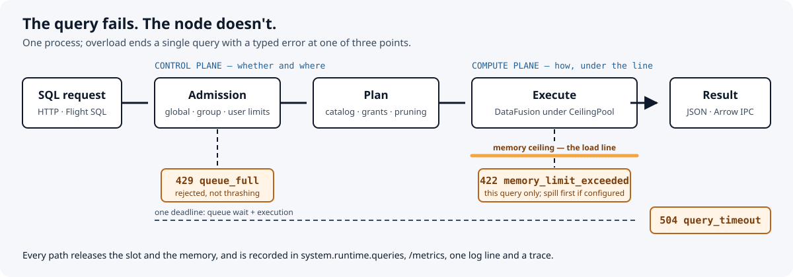

<a id="top"></a>

[English](README.md) · **Português (Brasil)**

<p align="center">
  
</p>

<h1 align="center">Plimsoll</h1>

<p align="center">
  <b>A query falha. O nó não.</b><br>
  Um motor SQL de lakehouse aberto, em Rust, sobre Apache DataFusion e Iceberg, em que sobrecarga encerra uma query — nunca o processo.
</p>

<p align="center">
  <a href="#veja-funcionando">Demo</a> · <a href="#início-rápido">Início rápido</a> · <a href="#como-funciona">Arquitetura</a> · <a href="docs/reference.md">Referência</a> · <a href="docs/adr/README.md">Decisões</a>
  <br>
  <sub>experimental <code>0.x</code>, construído para aprender — veja o <a href="CHANGELOG.md">CHANGELOG</a></sub>
</p>

Um motor de consultas que fica sem memória costuma derrubar todas as outras queries junto. O Plimsoll trata sobrecarga como **um resultado por query**: um teto de memória para o processo inteiro, limites de admissão e um deadline transformam uma query descontrolada em um erro tipado (`422`, `429`, `504`) enquanto o nó continua atendendo. Em volta dessa regra, ele implementa o núcleo de uma plataforma lakehouse — leitura e escrita Iceberg por catálogos REST, governança, execução distribuída — só com formatos abertos.

O nome vem da linha de carga no casco de um navio: carga acima da linha é recusada, e o navio zarpa.

## O que é — e o que não é

| É | Não é |
| --- | --- |
| Um motor SQL sobre **Apache Iceberg** (v1–v3) em object storage, por catálogos **Iceberg REST** (compatível com Polaris), além de Parquet e Postgres federado | Um clone do Databricks ou do Spark: sem notebooks, sem API Spark, sem formatos proprietários |
| Um serviço **governado**: tokens bearer, grants de leitura/escrita/drop por schema, colunas negadas, filtros de linha, trilha de auditoria das leituras | Uma fronteira contra tenants hostis: a autenticação é por token bearer, e o TLS não tem certificado de cliente |
| **Um binário** para todo papel: nó único, coordenador com workers, vários coordenadores | Um sistema de produção com SLA: é um projeto para aprender, em `0.x`, e a API HTTP pode mudar entre versões minor |
| **Seguro em recursos por construção**: todo operador reserva de um único `CeilingPool`; primeiro faz spill, depois falha a query | Uma promessa de que nada esgota o host: caminhos de alocação não rastreados estão listados como débito no [ADR 0003](docs/adr/0003-memory-ceiling.md), e um limite de container continua como defesa em profundidade |

## Veja funcionando

`make demo` sobe um nó local com teto de 64 MiB, uma vaga de execução, sem fila e deadline de 2 s, e o sobrecarrega de propósito. Sem Docker, sem catálogo, sem dados: toda query lê a função `range()` do DataFusion. Precisa de `cargo`, `curl` e `python3`; a primeira execução compila o servidor em debug (cerca de um minuto).

```text
node on http://127.0.0.1:46883 · ceiling 64 MiB · 1 running slot, no queue · 2 s deadline

  ✓ count 10M rows                           200   rows=10000000
  ✓ group by 5M keys (crosses the line)      422   memory_limit_exceeded, this query only
  ✓ node after the breach                    200   ready, pool back to 0 bytes
  ✓ second query while the slot is taken     429   queue_full, rejected instead of queued
  ✓ 10^10-row scan past its 2 s deadline     504   query_timeout, cancelled
  ✓ query after all of that                  200   slot and memory released

  /metrics: finished=2 failed=3 cancelled=0 · one process the whole time (pid 3819912)
demo passed
```

Cada linha é verificada, não só impressa: o script sai com erro se um status, um código de erro, a prontidão ou a volta do pool a 0 bytes não baterem. O CI roda a demo a cada push ([`scripts/demo.sh`](scripts/demo.sh)).

## Início rápido

Um catálogo Iceberg REST, um coordenador e dois workers num volume de warehouse local ([ADR 0123](docs/adr/0123-container-image-and-quickstart.md)). Docker com Compose v2.

```bash
TOKEN=$(openssl rand -hex 32)
export PLIMSOLL_AUTH_TOKENS="ana:sha256:$(printf %s "$TOKEN" | sha256sum | cut -d' ' -f1)"
export PLIMSOLL_WORKER_TOKEN=$(openssl rand -hex 16)
make up                   # docker compose up -d --wait

sql() { curl -s localhost:8080/v1/sql -H 'content-type: application/json' \
             -H "authorization: Bearer $TOKEN" -d "{\"sql\": \"$1\"}"; echo; }
sql "CREATE TABLE bronze.trips (id BIGINT, city VARCHAR, fare DOUBLE)"
sql "INSERT INTO bronze.trips VALUES (1, 'lisbon', 12.5), (2, 'porto', 8.0), (3, 'lisbon', 20.0)"
sql "SELECT city, count(*) AS trips, sum(fare) AS fares FROM bronze.trips GROUP BY city"

make down                 # docker compose down -v: também apaga o warehouse
```

A imagem `ghcr.io/joaolucas2210/plimsoll` é privada: depois de `docker login ghcr.io` com um token `read:packages`, ela é baixada; sem login, o Compose a compila localmente (cerca de 10 minutos). Os tokens são configurados como digests SHA-256, então o servidor nunca os guarda em claro ([ADR 0021](docs/adr/0021-bearer-token-authentication.md)).

- **Console web:** http://localhost:8080, com login por `$TOKEN`: árvore do catálogo, editor SQL (Ctrl+Enter), resultados, cancelamento ([ADR 0135](docs/adr/0135-web-console.md)).
- **Arrow Flight SQL** na porta 32010, usuário `ana`, senha `$TOKEN`: ADBC, o driver JDBC do Flight SQL, DBeaver ([ADR 0124](docs/adr/0124-flight-sql.md)).

```python
import adbc_driver_flightsql.dbapi as flightsql   # pip install adbc-driver-flightsql pyarrow
conn = flightsql.connect("grpc://localhost:32010", db_kwargs={"username": "ana", "password": TOKEN})
cur = conn.cursor()
cur.execute("SELECT city, count(*) FROM bronze.trips GROUP BY city")
print(cur.fetch_arrow_table())
```

## Como funciona



O sistema é dividido em dois planos ([ADR 0002](docs/adr/0002-platform-planes.md)):

- O **plano de controle** decide *se e onde* uma query roda: admissão (global, por grupo de recursos, por usuário), o registro de queries, deadlines e o cliente do catálogo Iceberg REST. Ele conhece a identidade das tabelas e onde está o metadado, nunca os dados, e nunca depende do DataFusion.
- O **plano de computação** decide *como*: o DataFusion planeja e executa, e todo operador reserva memória de um único `CeilingPool` do processo ([ADR 0003](docs/adr/0003-memory-ceiling.md)), que recusa uma reserva acima da linha e guarda uma fatia para resultados, para que uma query que já produziu linhas consiga entregá-las.

| Crate | Plano | Papel |
| --- | --- | --- |
| `plimsoll-core` | computação | Fachada do motor, `CeilingPool`, política de federação e guarda de filtros; nunca depende dos conectores |
| `plimsoll-connectors` | computação | Leitura, escrita e manutenção Iceberg, Parquet, Postgres, fragmentos e shuffles distribuídos |
| `plimsoll-control` | controle | Admissão, registro, cliente Iceberg REST, `system.runtime.queries`; sem DataFusion |
| `plimsoll-server` | borda | O único binário: HTTP (axum), Flight SQL (tonic), autenticação, TLS, configuração, observabilidade |

O `scripts/gates.sh` reprova o build se uma dependência atravessar um plano. A vida completa de uma query, a distribuição e o caminho do lakehouse: [docs/architecture.md](docs/architecture.md).

## O que suporta

| Área | Implementado | Decisões |
| --- | --- | --- |
| Leitura Iceberg | exclusões merge-on-read posicionais e por igualdade, deletion vectors v3, time travel por snapshot, instante, branch ou tag, tabelas de metadado (`$snapshots`, `$files`, `$partitions`…), evolução de schema por field id, poda por partição e por estatísticas | [0007](docs/adr/0007-iceberg-read-path.md)–[0017](docs/adr/0017-format-v3-deletion-vectors.md), [0028](docs/adr/0028-iceberg-time-travel.md)–[0032](docs/adr/0032-iceberg-file-metadata-tables.md) |
| Escrita Iceberg | `CREATE [AS SELECT]`, `ALTER`, `DROP`, `INSERT`, `UPDATE`, `DELETE`, `MERGE`, um commit de snapshot por comando; compactação, expiração de snapshots e remoção de órfãos | [0075](docs/adr/0075-insert-into-iceberg.md)–[0090](docs/adr/0090-create-table-as-select.md) |
| Governança | tokens como digests SHA-256, grants de leitura/escrita/drop por schema, colunas negadas e filtros de linha em todo scan depois da otimização, grupos de recursos com fatias de memória | [0021](docs/adr/0021-bearer-token-authentication.md)–[0025](docs/adr/0025-schema-grants.md), [0044](docs/adr/0044-column-deny.md)–[0046](docs/adr/0046-audit-trail.md) |
| Distribuição | coordenador e workers: scans remotos, agregação parcial, shuffles, joins broadcast e por shuffle com divisão de skew, escritas nos workers; vários coordenadores com admissão compartilhada ou por líder eleito | [0058](docs/adr/0058-scan-fragments-on-workers.md)–[0074](docs/adr/0074-shuffle-maps-expire-with-their-query.md), [0101](docs/adr/0101-several-coordinators.md)–[0110](docs/adr/0110-back-off-fast-rounds.md) |
| Interfaces | HTTP `/v1/sql` (JSON, NDJSON ou Arrow IPC em streaming, parâmetros ligados, cancelamento), Arrow Flight SQL, console web | [0035](docs/adr/0035-streamed-results.md), [0037](docs/adr/0037-arrow-ipc-results.md), [0043](docs/adr/0043-query-parameters.md), [0124](docs/adr/0124-flight-sql.md) |
| Operação | logs JSON, log de queries lentas, traces e métricas OTLP, `/metrics` Prometheus, drain no SIGTERM, TLS no processo; releases amd64/arm64 assinados com SBOM | [0026](docs/adr/0026-shutdown-drain.md), [0031](docs/adr/0031-query-traces.md), [0099](docs/adr/0099-tls-and-broadcast-limit.md), [0131](docs/adr/0131-signed-releases.md) |

**TPC-H.** Num nó com teto de 4 GiB, as 22 queries passam na checagem — SF1 em 2,4 s e SF10 em 32 s num notebook de 12 threads. No coordenador com dois workers do início rápido, sobre Iceberg, também passam as 22. A checagem compara a contagem de linhas e a primeira linha de cada query com a resposta do DuckDB, não o resultado inteiro. A execução em cluster mede corretude, não ganho de velocidade: todos os nós dividiram uma máquina ([ADR 0126](docs/adr/0126-tpch-benchmark.md), [ADR 0128](docs/adr/0128-tpch-on-a-cluster.md)).

## Limites e próximos passos

- Fontes de `MERGE` acima do limite de broadcast fazem o merge no coordenador: correto, mas não escala ([ADR 0130](docs/adr/0130-merge-sources-over-the-broadcast-limit.md)).
- Scans federados de Postgres ficam no coordenador. O Postgres recebe só os filtros cuja semântica é comprovadamente idêntica, e todo outro filtro é reaplicado localmente ([ADR 0005](docs/adr/0005-federation-correctness.md)).
- O lado de build de hash joins não faz spill (limite do DataFusion upstream), e alguns caminhos de alocação são contabilizados mas não recusados ([ADR 0003](docs/adr/0003-memory-ceiling.md), lista de débitos).
- A autenticação é só por token bearer: sem certificado de cliente, sem provedor de identidade externo.

Tudo o que foi feito e o que falta, por área: [ROADMAP.md](ROADMAP.md).

## Desenvolvimento

Rust ≥ 1.94 (edition 2024). `make help` lista os pontos de entrada.

```bash
make demo                      # a linha de carga, ao vivo, num nó
make gates                     # fmt, clippy -D warnings, cargo test --workspace, invariantes de plano
cargo run -p plimsoll-server   # com PLIMSOLL_AUTH_TOKENS definido, ou PLIMSOLL_AUTH=disabled para testes locais
```

A configuração é só por variáveis de ambiente, e valores inválidos abortam a inicialização: [todas as variáveis, a API SQL e a manutenção de tabelas](docs/reference.md) (em inglês). Além dos gates e da demo, o CI roda testes reais contra Postgres, S3 (SeaweedFS) e um catálogo Iceberg REST, e uma execução semanal de interoperabilidade contra tabelas escritas pelo Spark e pelo Iceberg Java.

Cada decisão tem um ADR com contexto, opções, consequências e débito aceito — [0001 a 0135](docs/adr/README.md), com uma ordem de leitura sugerida. Os releases saem de tags `v*`: [CHANGELOG](CHANGELOG.md).

Licenciado sob [Apache-2.0](LICENSE).
